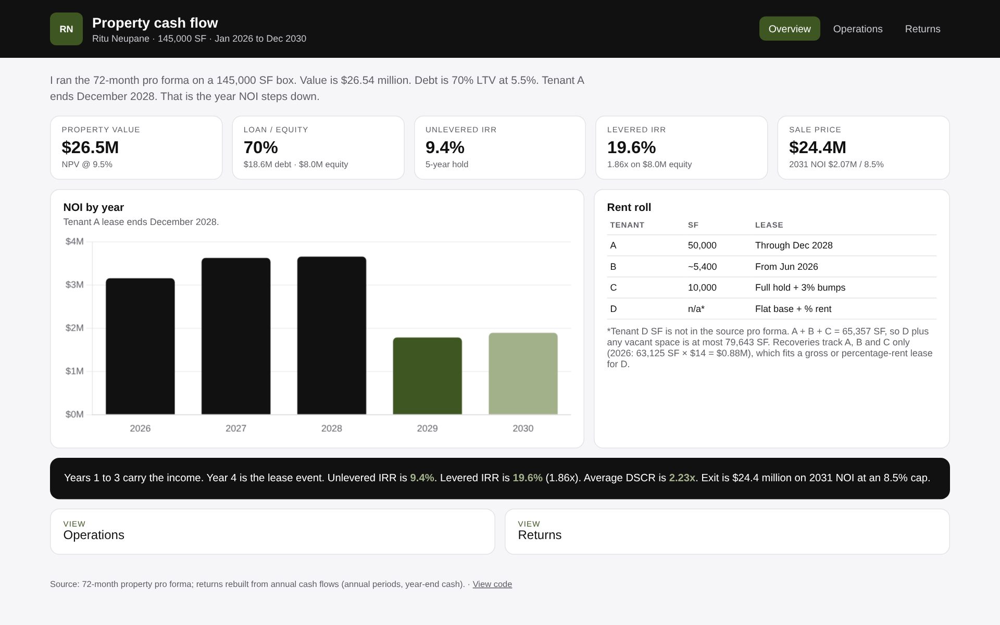
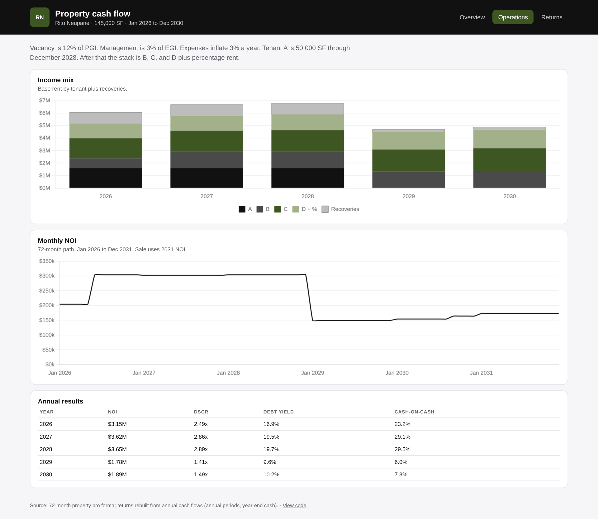
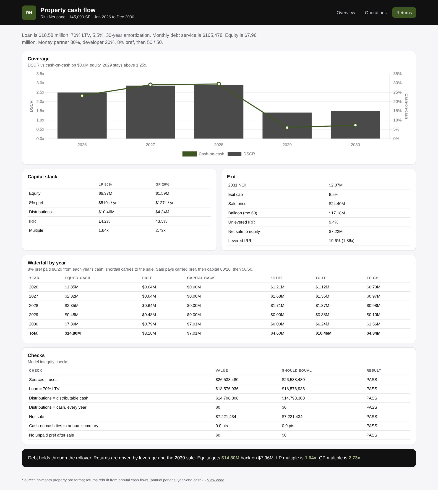

**Live dashboard:** https://rituneupane.github.io/property-cash-flow-insights/

# Property cash flow

I built a five-year cash flow for a 145,000 SF multi-tenant property. Hold is January 2026 to December 2030. Sale uses 2031 NOI at an 8.5% cap.

**Ritu Neupane** · New York

This is my underwriting. Tenants are anonymized A to D.

## What I looked at

1. Does the hold still cover debt after Tenant A leaves?
2. Where does NOI actually come from?
3. What do LP and GP take home after the 8% pref?

## What I found

- Property value **$26.54 million** (NPV at 9.5%). Loan **$18.58 million** (70% LTV, 5.5%).
- Unlevered IRR **9.4%**. Levered IRR **19.6%** (1.86x).
- 2028 NOI **$3.65 million** → 2029 NOI **$1.78 million**. Tenant A ends December 2028.
- Average DSCR **2.23x**. 2029 still above 1.25x.
- Exit **$24.40 million**. LP 1.64x / 14.2% IRR. GP 2.73x / 43.5% IRR.

## Checks

Returns are rebuilt from the annual cash flows in `analysis/model.py` (annual periods, year-end cash). It writes `data/checks.csv`:

| Check | Value | Should equal | Result |
|---|---|---|---|
| Sources = uses | $26,538,480 | $26,538,480 | PASS |
| Loan = 70% LTV | $18,576,936 | $18,576,936 | PASS |
| Distributions = distributable cash | $14,798,308 | $14,798,308 | PASS |
| Distributions = cash, every year | $0 | $0 | PASS |
| Net sale | $7,221,434 | $7,221,434 | PASS |
| Cash-on-cash ties to annual_summary.csv | 0.0 pts | 0.0 pts | PASS |
| No unpaid pref after sale | $0 | $0 | PASS |

Run `python analysis/model.py` to rebuild the returns and checks.

## Dashboard

**Overview**



**Operations**



**Returns**



Live board (Overview, Operations, Returns): https://rituneupane.github.io/property-cash-flow-insights/ (source in `docs/`).

## Files

```
docs/                  live dashboard (Overview, Operations, Returns)
analysis/model.py      rebuilds returns, waterfall and checks
data/annual_summary.csv
data/annual_cash_flows.csv
data/waterfall_by_year.csv
data/checks.csv
data/assumptions.csv
data/tenant_rent_roll.csv
data/partnership_waterfall.csv
data/SOURCES.md
reports/property_memo.md
analysis/notes.md
screenshots/           overview, operations, returns
```

Open the CSVs in Excel if you want to check the math, or run `python analysis/model.py`.

MIT License.
